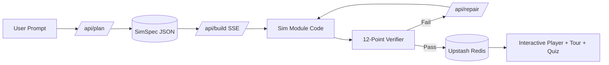

# PlayTheory 🎮🧪

> **From natural-language concept to working, verified, interactive simulation in seconds.**  
> Built for IceHacks 2026 (Targeting: *Best Deployed / Shipped App* & *Best AI Hack*).

---

## 🌟 The Problem & One-Liner

Textbooks and standard LLMs give learners static paragraphs and flat diagrams. Real understanding happens when you can poke a system, crank a slider, and see what breaks.

**PlayTheory** is a **compound AI system** that turns any concept (*"TCP congestion control"*, *"Lotka-Volterra predator-prey"*, *"how vaccines train the immune system"*) into a fully working, interactive simulation with:
- 🎛️ **Live parameter sliders & multi-series plots**
- 🧭 **Guided predict-then-reveal tour**
- ❓ **Interactive misconception callouts & quiz**
- 🛡️ **Autonomous verification & live self-repair pipeline**

---

## ⚙️ How It Works (The Compound AI Pipeline)

Unlike chatbot wrappers, PlayTheory compiles code against a constrained mathematical runtime, executes a 12-point client-side verifier harness, and self-repairs in real time:



---

## 🚀 Quickstart

### Prerequisites
- Node.js 18+ (tested on Node.js 20+)
- npm or pnpm

### 1. Clone & Install
```bash
git clone https://github.com/akstar256/playtheory.git
cd playtheory
npm install
```

### 2. Configure Environment
```bash
cp .env.example .env.local
```
Fill in your Google AI Studio or OpenAI API key, and optional Upstash Redis credentials.

### 3. Run Locally
```bash
npm run dev
```
Open [http://localhost:3000](http://localhost:3000) to see the application.

---

## 🧪 Testing & Verification

```bash
# Run strict TypeScript typecheck
npm run typecheck

# Run ESLint
npm run lint

# Run Vitest unit tests
npm run test

# Run CI check
npm run ci

# Run smoke test against local or remote URL
npm run smoke http://localhost:3000
```

---

## 📁 Repository Structure

```
playtheory/
  app/                      # Next.js App Router (pages & API routes)
    api/{health,plan,build,repair,guide,sims,gallery,stats}/
    s/[slug]/  about/  status/
  components/               # UI components (Timeline, SimPlayer, ParamPanel, Plots, TourPanel)
  lib/
    llm/                    # Provider adapters, prompts, token & spend tracking
    pipeline/               # Planner, builder, repair state machine
    verify/                 # Static analysis, loop-guard AST, headless worker, canvas checks
    runtime/                # SimKit math & drawing helpers, sandboxed iframe host
    archetypes/             # Hand-verified exemplar modules & specs
    store/                  # Dual-mode store (Upstash Redis + in-memory fallback)
  scripts/                  # seed-gallery.ts, eval.ts, smoke.ts
  docs/                     # ARCHITECTURE.md, EVAL.md, DESIGN.md, DEPLOY.md
```

---

## 📜 Disclosure & Hackathon Tracks

- **Tracks**: Best Deployed / Shipped App & Best AI Hack
- **AI Tooling Disclosure**: See [AI_USAGE.md](file:///Users/ameykaulavkar/Documents/GitHub/playtheory/AI_USAGE.md) for full disclosure of models and developer tools used.
