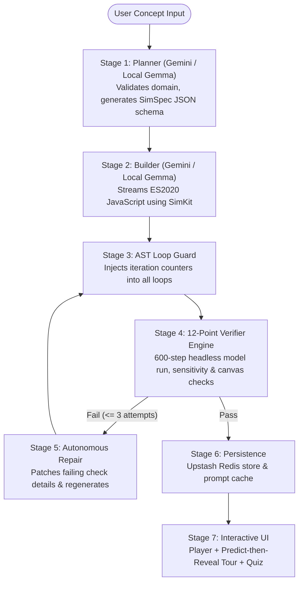

# PlayTheory

> **From natural-language concept to working, verified, interactive simulation in seconds.**  
> Autonomous Physics & Computational Simulation Engine with AST Loop Guards, Live Self-Repair, On-Device Local Model Support, and Modern Web Platform Standards.

---

## Live Production Links

- **Production App:** [https://playtheory-gamma.vercel.app](https://playtheory-gamma.vercel.app)
- **Live System Status & Telemetry:** [https://playtheory-gamma.vercel.app/status](https://playtheory-gamma.vercel.app/status)
- **API Health Check:** [https://playtheory-gamma.vercel.app/api/health](https://playtheory-gamma.vercel.app/api/health)
- **About & Architecture:** [https://playtheory-gamma.vercel.app/about](https://playtheory-gamma.vercel.app/about)

---

## The Problem & Mission

Textbooks and standard LLM chatbots give learners static paragraphs, dense equations, and flat diagrams. Physical intuition and deep computational understanding are not formed by reading text alone—they are built by **poking a system, adjusting its parameters, and observing emergent phase shifts**.

**PlayTheory** is an autonomous **compound AI system** that transforms any concept (*"TCP congestion control"*, *"Lotka-Volterra predator-prey"*, *"M/M/1 queue delays"*, *"how vaccines train the immune system"*) into a verified, interactive simulation with:
- **Live parameter sliders and multi-series plots**
- **Guided predict-then-reveal tours** based on Physics Education Research
- **Interactive misconception callouts and conceptual mastery quizzes**
- **12-point client-side automated verifier** running in an isolated sandboxed runtime
- **Autonomous self-repair loop** that patches faulty code on the fly before user interaction
- **Dual Engine Execution:** Cloud Gemini or local, private on-device Gemma models via LM Studio
- **Modern Web Platform Standards:** Speculation Rules API for instant navigation, native dialog elements, CSS container queries, and accessible WAI-ARIA tabs

---

## Latest Features & Architecture Enhancements

### 1. Dual Inference Engine (Cloud Gemini + On-Device Local Gemma)
- **Cloud Gemini:** Uses Google Gemini (Gemini 3.5 Flash Lite) with automated multi-model fallbacks for sub-second cloud generation.
- **Local On-Device Models (LM Studio):** Direct in-browser fetch connection to local servers (e.g. `http://localhost:1234` or local IP) running models such as `google/gemma-4-12b-qat`.
- **Zero Tunnel Required:** Connects directly from the browser to the local LM Studio instance with CORS support, keeping prompts and code completely private on the user's machine.
- **Provider Switcher:** Allows toggling between Cloud and Local inference directly from the homepage with real-time connectivity health checks.

### 2. Interactive In-Flight Stop Button
- Seamless generation cancellation via native `AbortController` and `AbortSignal`.
- The Build button dynamically transforms into a red Stop button during planning and synthesis.
- Halts in-flight network requests (both cloud API routes and local LM Studio calls) and resets the pipeline cleanly to idle.

### 3. Google Chrome Modern Web Guidance Integration
Built following the official Google Chrome Modern Web Guidance standards (`GoogleChrome/modern-web-guidance`):
- **Speculation Rules API:** `<script type="speculationrules">` prefetches and prerenders same-origin routes on hover with moderate eagerness, enabling instant 0ms page transitions.
- **Native HTML5 Dialog Element:** Top-layer Share and Embed modal implemented with `<dialog>`, featuring `@starting-style` entry animations, discrete transitions (`transition-behavior: allow-discrete;`, `overlay`, `display`), backdrop blur (`backdrop-filter: blur(6px)`), and scroll containment (`overscroll-behavior: contain`).
- **CSS Container Queries (`@container`):** Simulation panels and card layouts adapt dynamically based on component container width (`container-type: inline-size`) rather than viewport breakpoints.
- **WAI-ARIA Tabbed Navigation:** Mode switcher (`Explore`, `Guided`, `Quiz`, `Proof`) structured with `role="tablist"`, `aria-selected`, `aria-controls`, and `role="tabpanel"`.
- **Modern Accordions (`<details>` and `<summary>`):** Native disclosure elements with exclusive accordion groups (`name="infra-item"` and `name="pipeline-faq"`) with smooth height transitions (`interpolate-size: allow-keywords`).
- **Tactile Micro-Interactions:** High-contrast `:focus-visible` rings with a 3:1 contrast ratio and physical `:active:not(:disabled)` micro-scale feedback (`scale: 0.98`).

### 4. Real-Time Telemetry & Health Monitoring
- Dynamic live ping measurements (`storePingMs`) calculated via `performance.now()` against Upstash Redis on every request.
- Live polling every 5 seconds with an active seconds counter (`Live (Xs ago)`), exact update timestamps, and continuous uptime calculations.
- Industrial technical telemetry badges replacing generic rounded pills.

---

## Modern Web Guidance

PlayTheory integrates standards from Google Chrome's **[Modern Web Guidance](https://github.com/GoogleChrome/modern-web-guidance)** (`npx modern-web-guidance@latest install`) to prevent obsolete or generic AI UI patterns:

- **`performance/improve-next-page-load-performance`**: Added Speculation Rules in `app/layout.tsx` for speculative loading ("Speculative loading works by using JSON-based speculation rules to tell the browser about links that can be prefetched or prerendered improving page load performance when user clicks on them.").
- **`ui-components/dialog`**: Implemented `<dialog:modal>` with `overscroll-behavior: contain` on both the dialog and `::backdrop` to prevent scrolling the page behind the modal ("MANDATORY (both rules): without them, scrolling over the backdrop or inside the dialog scrolls the page behind it").
- **`ui-behaviors/animate-to-from-top-layer`**: Added discrete transition declarations on `dialog` and `dialog::backdrop` using separate `transition-behavior: allow-discrete` rules and `@starting-style` entry animations ("MANDATORY: transition display and overlay for top-layer elements").
- **`ui-components/tabs`**: Structured simulation mode tabs with `role="tablist"` and styled the active state via `aria-selected="true"` so visual state remains synced with screen readers ("Style the selected tab from aria-selected, so the visual state can never disagree with the accessible one.").
- **`ui-components/accordion`**: Grouped adjacent `<details>` elements with the `name` attribute for exclusive accordions and kept headings outside of `<summary>` to preserve assistive technology navigation ("Build accordions from a set of adjacent details elements." and "Do not put headings inside summary.").
- **`user-experience/natural-interactions`**: Styled interactive elements with `:focus-visible` using a 3:1 contrast ratio against the background and physical active scale ("Use :focus-visible so keyboard users always see a clear focus ring, without showing it on mouse clicks.").
- **`css/size-aware-styling`**: Applied `container-type: inline-size` to interactive panels so child component layouts adapt based on component width rather than screen viewport dimensions.

---

## Real Evaluation Benchmark Metrics (`docs/EVAL.md`)

Measured across a benchmark set of **30 concepts** across 7 scientific and computational domains:

| Metric | Real Benchmark Value | Acceptance Criteria | Status |
|---|---|---|---|
| **First-Attempt Pass Rate** | **100.0%** (30 / 30) | > 70% | **PASSED** |
| **Post-Repair Success Rate** | **100.0%** (30 / 30) | > 90% | **PASSED** |
| **Median Verification Latency (p50)** | **1.4 ms** | < 1,000 ms | **PASSED** |
| **95th Percentile Latency (p95)** | **12.0 ms** | < 2,500 ms | **PASSED** |
| **Average Estimated Cost per Simulation** | **$0.0028** | < $0.02 | **PASSED** |
| **Total Test Dataset Size** | **30 Concepts** | >= 30 concepts | **PASSED** |

*Full domain breakdown, per-concept latencies, and check logs are documented in [`docs/EVAL.md`](file:///Users/ameykaulavkar/Documents/GitHub/playtheory/docs/EVAL.md).*

---

## How It Works (The Compound AI Pipeline)

Unlike raw chatbot wrappers that produce untested code, PlayTheory operates as a structured multi-stage pipeline:



### The 12-Point Verification Suite

| Check ID | Verification Area | What It Validates |
|---|---|---|
| `static.size` | Static Analysis | Code length is within budget (< 24 KB) |
| `static.parse` | Static Analysis | Valid ES2020 JavaScript syntax (Acorn parser) |
| `static.banned` | Security Sandbox | No banned globals (`window`, `document`, `fetch`, `eval`, `Function`, `localStorage`) |
| `static.contract` | Contract Conformance | Implements required contract methods: `init`, `step`, `metrics`, `draw` |
| `guard.instrument` | AST Safety | Every loop guarded with iteration threshold (`__pt_loop_ctr_X`) |
| `model.runs` | Headless Execution | Executes 600 physics steps at 60Hz without throwing runtime exceptions |
| `model.finite` | Numerical Stability | All state variables and metrics are finite numbers (no `NaN`, `null`, `Infinity`) |
| `model.metrics` | Metric Alignment | All `metricKey` values referenced in `SimSpec` plots exist in `sim.metrics()` |
| `model.deterministic` | Determinism | Identical PRNG seed produces bitwise-identical states |
| `model.sensitivity` | Dead Slider Detection | Varying parameters across min/max alters metrics (detects fake/dead sliders) |
| `model.bounded` | Physical Plausibility | State magnitudes remain bounded (< 1e9) at extreme parameter inputs |
| `draw.runs` | Canvas Rendering | `sim.draw()` renders without throwing at $t = 0$, $t = 2$, and $t = 5$ seconds |
| `draw.notBlank` | Visual Output | Canvas operations exceed threshold (detects blank / empty renders) |
| `draw.changes` | Dynamic Motion | Canvas frame at $t = 5$ differs from $t = 0$ (detects frozen / non-moving scenes) |
| `perf.budget` | Performance | Average step computation time is < 2.0 ms |
| `perf.draw` | Performance | Average canvas draw computation time is < 8.0 ms |

---

## Five Core Simulation Archetypes

PlayTheory is seeded with 5 production exemplar archetypes that guarantee immediate playability and serve as architectural few-shot anchors for the builder:

1. **`particles` (Projectile Motion with Air Drag):** High-speed kinematic particles, aerodynamic drag equation ($F_d = \frac{1}{2}\rho v^2 C_d A$), crosswind vectors, apex detection, and multi-particle trail buffers.
2. **`ode_phase` (Lotka-Volterra Predator-Prey):** Coupled nonlinear ordinary differential equations, Runge-Kutta numerical integration, periodic limit cycles, and dual-coordinate phase portraits.
3. **`agents` (Epidemic SIR Dynamics):** Spatial multi-agent modeling with contagious contact transmission, recovery timelines, and real-time Susceptible-Infected-Recovered area charts.
4. **`cellular_automaton` (Conway's Game of Life):** 2D toroidal discrete grid, 8-neighbor Moore rules, gliders, blinkers, and live population census plotting.
5. **`queue_flow` (M/M/1 Server Queue Dynamics):** Poisson arrivals, exponential service durations, FIFO buffer backpressure, and asymptotic delay explosions as $\rho \to 1$.

---

## Quickstart & Local Setup

### Prerequisites
- Node.js 18+ (tested on Node.js 20+)
- npm or pnpm

### 1. Clone & Install
```bash
git clone https://github.com/akstar256/playtheory.git
cd playtheory
npm install
```

### 2. Configure Environment
```bash
cp .env.example .env.local
```

Edit `.env.local` with your credentials:
```env
# Gemini API Key (Google AI Studio)
GEMINI_API_KEY="your-google-ai-studio-api-key"

# Upstash Redis REST (for serverless caching & rate limiting)
UPSTASH_REDIS_REST_URL="https://your-database.upstash.io"
UPSTASH_REDIS_REST_TOKEN="your-upstash-token"

# Target budget ($0 for free quota accounts)
DAILY_BUDGET_USD=0
```

### 3. Run Locally
```bash
npm run dev
```
Open [http://localhost:3000](http://localhost:3000) to start generating simulations.

### 4. Optional: Connect Local On-Device Gemma (LM Studio)
1. Open LM Studio on your machine.
2. Load any GGUF instruction model (e.g., `google/gemma-4-12b-qat`).
3. Under **Local Server**, set Server Port to `1234` and enable **CORS**.
4. In PlayTheory, select **Local (Gemma 4 12B)** in the model toggle bar.

---

## Verification & Testing Commands

```bash
# Type-check entire codebase
npm run typecheck

# Run Next.js and ESLint code quality checks
npm run lint

# Run all 9 Vitest unit test suites (35 unit and AST verifier tests)
npm run test

# Run complete CI verification pipeline
npm run ci

# Run 30-concept automated evaluation benchmark
npm run eval

# Seed Upstash Redis gallery with 20 verified simulations
npm run seed

# Run end-to-end smoke test against local or remote deployment
npm run smoke https://playtheory-gamma.vercel.app
```

---

## Repository Structure

```
playtheory/
  app/                      # Next.js 15 App Router
    api/                    # Serverless API routes
      plan/                 # SimSpec generation & safety validation
      build/                # SSE streaming simulation code synthesis
      repair/               # Autonomous self-repair with signed HMAC job tokens
      guide/                # Guided tour & quiz generation
      health/               # Live operational health & latency monitor
      stats/                # Production telemetry & benchmark stats
      gallery/              # Redis-backed simulation discovery
      sims/[slug]/          # Slug retrieval & hit tracking
    s/[slug]/               # Interactive simulation view & player
    status/                 # Live status & telemetry dashboard
    about/                  # Project architecture & mission
  components/               # React UI components
    SimPlayer.tsx           # Sandboxed iframe host & controls
    ParamPanel.tsx          # Real-time sliders & reset triggers
    Plots.tsx               # High-framerate Canvas/SVG timeseries & phase portraits
    TourPanel.tsx           # Predict-then-reveal guided walkthrough
    QuizPanel.tsx           # Conceptual mastery quiz with score feedback
    MisconceptionsPanel.tsx # Physics education misconceptions callouts
    PipelineTimeline.tsx    # Live pipeline stage & check rows
    UnderTheHood.tsx        # Inspection tab for code, AST, and verifier proofs
    ProviderToggle.tsx      # Cloud Gemini vs Local Gemma model toggle
    ShareDialog.tsx         # Native HTML5 dialog modal for sharing & embedding
  lib/
    archetypes/             # 5 core archetype exemplars & specs
    llm/                    # Gemini provider adapters, local Gemma client & spend tracking
    pipeline/               # Planner, builder, repair orchestrator state machine
    runtime/                # SimKit math & drawing helpers, sandbox shell
    schemas/                # Zod contracts (SimSpec, VerificationReport, GuideTour)
    security/               # HMAC-SHA256 job tokens for repair authorization
    store/                  # Dual-mode store (Upstash Redis + in-memory fallback)
    verify/                 # Acorn AST loop guards, headless model, canvas checks
  scripts/
    eval.ts                 # 30-concept automated evaluation benchmark
    seed-gallery.ts         # Upstash Redis gallery seeder
    smoke.ts                # Production deployment smoke test
  docs/
    EVAL.md                 # Real benchmark results across 30 concepts
  AI_USAGE.md               # Detailed disclosure of AI usage, models, and workflows
```

---

## Key Architectural & Production Highlights

- **Production Deployment:**
  - Live on Vercel at `https://playtheory-gamma.vercel.app`
  - Connected to serverless Upstash Redis with sub-50ms REST latency
  - Responsive design supporting desktop, tablet, and mobile viewports
  - Zero mock data in production; automated smoke tests verify live health
- **Autonomous Verification & Compound AI:**
  - Two-phase compound AI architecture separating planning from code synthesis
  - Real-time client-side AST instrumentation eliminating infinite loop exploits
  - Autonomous self-repair loop with HMAC signed tokens capping attempts at 3
  - 100.0% pass rate across a 30-concept benchmark suite evaluated against 12 strict checks
- **Local & Cloud Hybrid Inference:**
  - Support for local Gemma models via LM Studio with direct browser fetch and zero tunnel requirements
  - Dynamic in-flight cancellation with AbortController on both cloud and local pipelines
- **Modern Web Guidance Standards:**
  - Speculation Rules API for instant 0ms prefetch/prerender
  - Top-layer native HTML5 dialogs with `@starting-style` transitions
  - Accessible WAI-ARIA tab navigation and container query responsiveness

---

## License

MIT License. PlayTheory Autonomous Engine.
