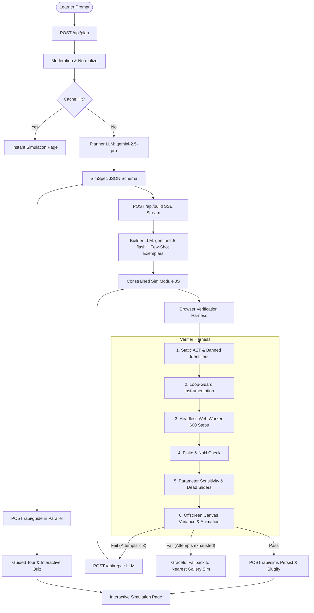

# PlayTheory — System Architecture

## 1. Overview
PlayTheory is a **compound AI system** that transforms natural-language concept prompts into verified, interactive, sandboxed JavaScript simulations with live plots, guided predict-then-reveal tours, and misconception quizzes.

Unlike chat-based LLM wrappers, PlayTheory implements a strict generative compile-and-verify loop:
1. **Simulation Planner**: Produces a structured mathematical and visual specification (`SimSpec`).
2. **Code Builder**: Generates constrained simulation code adhering to the `SimKit` runtime interface.
3. **Automated Verifier**: Validates AST safety, numerical stability, parameter sensitivity, and rendering sanity inside an isolated browser environment.
4. **Self-Repair Loop**: Feeds structured verifier errors back to the model for iterative correction (up to 3 attempts).

---

## 2. Pipeline Flow Diagram



---

## 3. Data Contracts

### 3.1 `SimSpec` (Zod-validated)
- `schemaVersion`: 1
- `safety`: `{ allowed: boolean; reason?: string }`
- `title`, `concept`, `level`, `archetype`
- `coreIdea`: max 2 sentences
- `learningObjectives`: 3-4 items
- `stateVariables`: array of variable descriptors
- `parameters`: 2-6 sliders (`id, label, min, max, step, default, unit, description, effectHint`)
- `dynamics`: physical equations / plain-text rules
- `visual`: canvas description, encodings, and 1-3 plot configs
- `presets`: 3-5 parameter states
- `misconceptions`: 2-3 common myths vs reality
- `quiz`: 4 multiple-choice questions

### 3.2 Simulation Module Interface
Single JavaScript script defining:
```javascript
const sim = {
  init(params, rng) { /* returns state object */ },
  step(state, params, dt, rng) { /* mutates state in place by dt */ },
  metrics(state, params) { /* returns key-value numerical metrics */ },
  draw(ctx, state, params, view) { /* renders to 960x600 canvas */ }
};
```

---

## 4. Security & Sandboxing
- Simulations execute inside `<iframe sandbox="allow-scripts">` without `allow-same-origin`.
- Strict Content Security Policy (CSP): `default-src 'none'; script-src 'unsafe-inline'; style-src 'unsafe-inline'; img-src data:`.
- Banned globals: `fetch`, `XMLHttpRequest`, `WebSocket`, `eval`, `localStorage`, `setTimeout`, `setInterval`, `Math.random` (use host `rng`).
- AST Loop-Guard: Acorn parser rewrites loops to insert iteration counters; throws `LoopBudgetError` if iterations exceed 1e6.
- Signed job tokens: HMAC SHA-256 tokens signed by `JOB_TOKEN_SECRET` prevent replay and unbounded repair iterations.
